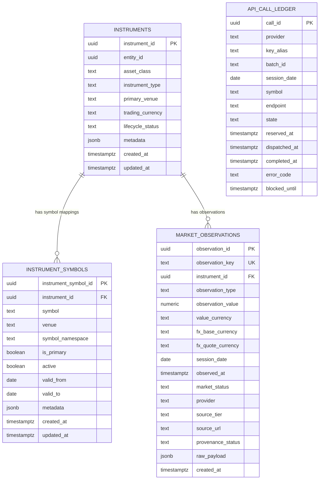
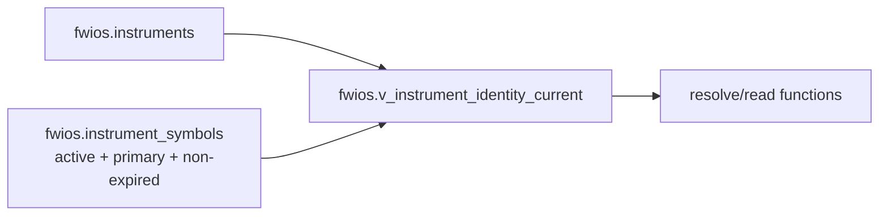

# FWIOS Database ERD

**Architecture version:** DB-ARCH-1.0  
**Doc revision:** DOC-REV-3  
**Status:** CURRENT  
**Verified against live Supabase:** 2026-11-06 10:26:42 UTC

## Core application ERD

## Relationship notes

### `fwios.instruments -> fwios.instrument_symbols`

Physical FK:

`instrument_symbols.instrument_id -> instruments.instrument_id`

An instrument may have multiple symbol mappings over time. The current identity read selects active, non-expired, primary symbol mappings.

### `fwios.instruments -> fwios.market_observations`

Physical FK:

`market_observations.instrument_id -> instruments.instrument_id`

Each price/FX observation is anchored to a canonical instrument.

### `fwios_quota.api_call_ledger`

There is deliberately **no physical FK** from the quota ledger to the canonical price tables.

The ledger records provider request reservations/outcomes by provider, batch, session and symbol. It is operational state. A successful provider call may lead to a canonical market observation only after worker validation.

## Current identity view

The view is a read projection, not a table and not a second identity authority.

## Important non-relational logical link

`api_call_ledger.symbol` and `batch_id` can be correlated operationally with provider collection, but this is not a referential FK to `instrument_symbols` or `market_observations`. Do not add a relationship line in the ERD unless a future approved schema creates a real FK or durable lineage key.

## Current vs future

This ERD contains only the current application relations.

Do not add Provider Registry, Capability Registry, raw-provider tables, normalized fundamentals, filing evidence, scoring or valuation tables here until they are actually deployed and verified as CURRENT.
