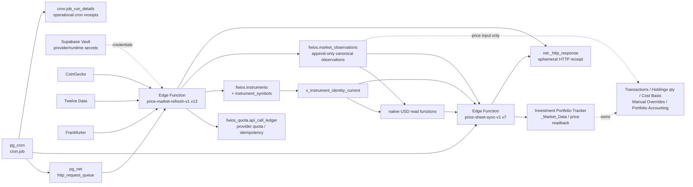

# FWIOS Current Data Flow

**Architecture version:** DB-ARCH-1.0  
**Doc revision:** DOC-REV-2  
**Status:** CURRENT  
**Verified against live Supabase:** 2026-11-06 10:26:42 UTC

## Current production flow

## Flow stages

### 1. Schedule and dispatch

`cron.job` defines schedules. Scheduled commands use pg_net/Edge Function dispatch. `cron.job_run_details` records cron execution status, while `net._http_response` is an ephemeral HTTP diagnostic receipt.

A cron row marked `succeeded` does not by itself prove that downstream provider collection or Sheet write succeeded.

### 2. Provider collection

The current market worker collects from the live provider paths used by the supported price service.

Provider Strategy v1 selects Massive and SEC for future workloads, but they are **not shown as current runtime inputs** because the current production database/worker has not been upgraded to use them yet.

Alpha Vantage is also intentionally omitted from the future/provider flow. Historical/live runtime code and rows may still contain Alpha references until an approved cutover removes them.

### 3. Quota/idempotency guard

For provider paths that use the quota guard, the worker reserves provider calls in `fwios_quota.api_call_ledger` before dispatch and records dispatch/completion outcome.

The ledger does not become market truth. It only proves/request-controls provider-call lifecycle.

### 4. Identity resolution

Provider symbols are resolved to canonical instrument identity through `instrument_symbols` / `instruments`.

A symbol is not accepted as the canonical database identity by itself.

### 5. Canonical observation write

Validated price/FX evidence is inserted into `fwios.market_observations`.

The insert path is idempotent through `observation_key`; UPDATE/DELETE is blocked by the append-only trigger during normal operation.

### 6. Read model

The current identity view plus native-USD read functions select eligible observations and expose read-only valuation status.

These functions do not place trades.

### 7. Google Sheet sync

`price-sheet-sync-v1` reads canonical price/identity state and writes the existing market-data surface used by the Investment Portfolio Tracker.

The Google Sheet remains the owner of accounting quantities and calculations.

## Data authority matrix

| Data | Current authority |
|---|---|
| Instrument identity | Supabase `fwios` |
| Canonical market observations | Supabase `fwios.market_observations` |
| Provider-call operational quota state | Supabase `fwios_quota.api_call_ledger` |
| Transactions | Investment Portfolio Tracker |
| Holdings quantities | Investment Portfolio Tracker |
| Cost Basis | Investment Portfolio Tracker |
| Manual Overrides | Investment Portfolio Tracker |
| Portfolio accounting / calculated P&L | Investment Portfolio Tracker |
| Cron receipts | pg_cron operational tables |
| HTTP receipts | pg_net ephemeral operational tables |
| Provider credentials | Supabase Vault |

## Upgrade rule

When a future database change alters any arrow above, update this file in the same architecture-document update as the schema change.

Examples that require a Data Flow update:

- adding a new persistent raw-provider layer;
- changing which table is canonical;
- introducing normalization between provider payload and canonical tables;
- changing worker write/read ownership;
- adding durable lineage/evidence;
- retiring the quota ledger;
- moving accounting ownership;
- changing provider routing in production.

A pure index change normally does not change this flow unless it also changes logical behavior.
