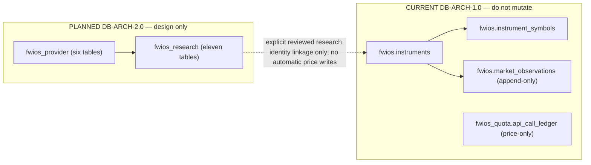
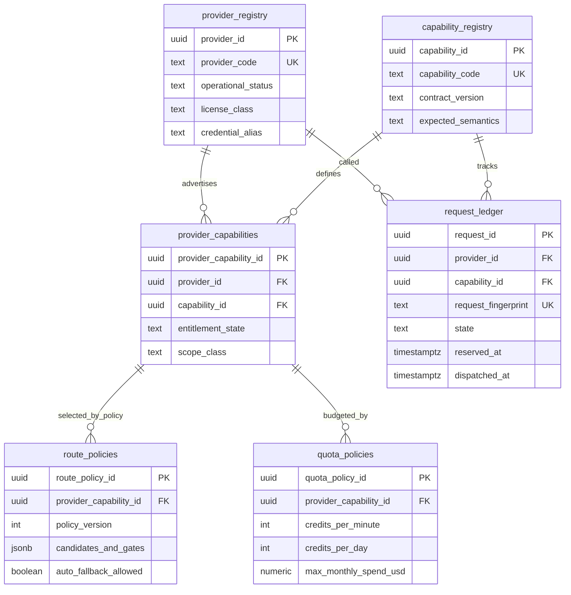
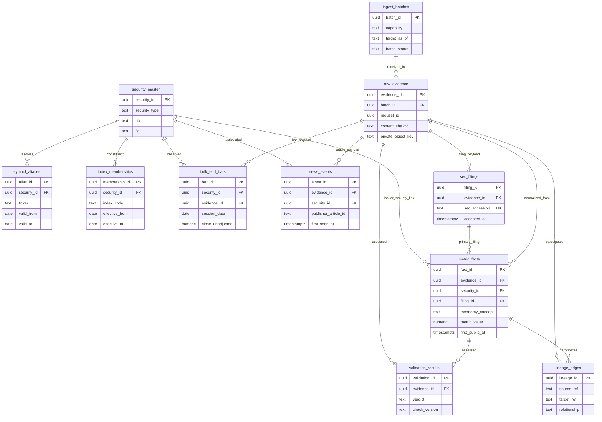

# DB-ARCH-2.0 — Proposed Entity Relationships
**STATUS: PLANNED / NOT DEPLOYED**. All edges below are **future design relationships**, not asserted current-production FKs. **Safety invariant:** `auto_trade=false`; no portfolio accounting or canonical price history mutation. Physical FKs should be applied only where explicit in [TABLE_CATALOG.md](TABLE_CATALOG.md) after separate implementation authorization.

## Existing current price-service footprint (separate, not redefined)

## Proposed Provider Control Plane (six new tables, all not deployed)

`route_policies.candidates_and_gates` has a required schema/validator and versioned ordered candidates; an unreviewed JSON route is not executable. For a production implementation, consider normalizing route candidates to a separate relation if review, queryability or effective-dating demands it.

## Proposed Research/Evidence Plane (eleven new tables, all not deployed)

### Cross-schema FK policy (future, not actual)

- `fwios_research.raw_evidence.request_id` may FK to `fwios_provider.request_ledger.request_id` **only after** the write-order/error-isolation design is reviewed. Until then it is a logical link with deterministic reconciliation checks.
- No FK from research security master to `fwios.instruments` in v1. A user holding an instrument does **not** automatically create 500 research price identities in the price service.
- `lineage_edges` is a typed logical audit graph; it is not a replacement for mandatory FKs on core evidence tables. Invalid references must fail validation.

## Cardinality and operational requirements

- One provider offers multiple capabilities; the same capability may have multiple provider/plan implementations.
- Multiple fact versions can exist for one issuer/concept/period; immutable source accession and `first_public_at` decide an **as-of** read.
- Index membership is effective-dated; never infer past membership from today's list.
- One fetch request can produce a batch of evidence items; each accepted item retains exact request provenance.
- Current production has **zero** tables from these two proposed private schemas. Their presence in diagrams is design intent only.
