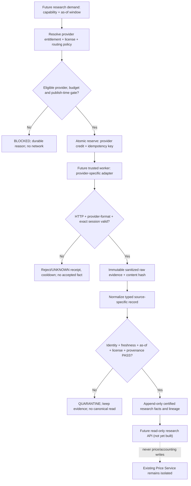
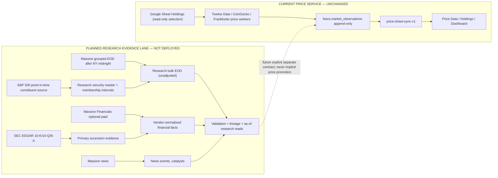

# DB-ARCH-2.0 — Multi-Provider Data Flow
**STATUS: PLANNED / NOT DEPLOYED**. Dashed components are future only. No production provider, worker, Cron, database or Sheet change is authorized by these diagrams.

## 1. Capability-specific routing (future research plane)

**Fallback semantics:** A fallback may be considered only if a route policy explicitly permits it and the primary failure type is eligible. `UNKNOWN` after dispatch is counted as spent; it cannot be silently retried under a fresh idempotency key. Fallback cannot fabricate completeness by combining incompatible source sessions or mixing adjusted and unadjusted closes.

## 2. Three separate workload lanes

**Important:** Massive grouped US-market prices are not historical S&P 500 members; if no legally usable historical membership is obtained, research must declare **current-universe-only** and disable membership-accurate historical backtests.

## 3. Exact time semantics

| Data kind | Source time | Publication/knowability | FWIOS as-of validation |
|---|---|---|---|
| Stock EOD | NY `session_date` and exchange timezone | Massive Free Basic prior EOD after 00:00 ET; Twelve Data per its independently certified session | No `adjusted=true` substitution, holiday/weekend backdate or current-vs-prior session mix |
| Financial statements | `fiscal_period_end` | SEC `accepted_at` / known first-public filing timestamp | Never infer availability from period end or latest restated vendor record |
| Metric ratios | vendor snapshot `observed_at` and underlying-period lineage | vendor publication or normalized computation time | Not assumed to be historical point-in-time ratios |
| SEC filing | accession and accepted filing timestamp | accepted/public filing time | Amendment recorded as distinct evidence; link prior versions |
| Index membership | interval `effective_from`/`effective_to` | source-published change timestamp when available | Separate valid-time and known-at time; require source license |
| News | publisher `published_at` | `first_seen_at` when system could have known article | Event-time vs ingestion-time kept separately; no re-dating |
| Crypto | USD quote `observed_at` | quote-time freshness | Preserve CoinGecko source, no silent substitution |
| FX | rate `value_date` | official provider publish timestamp | No label as intraday executable FX; record blend vs pinned-source |

## 4. Backpressure, retry and cost

- Future request planned => determine credits/cost from account entitlements; atomically reserve across all required slots.
- Rate limit, daily quota, monthly allocation and spend ceiling are independent conditions. If any blocks => no dispatch.
- Use bounded timeouts, bounded jitter for eligible pre-dispatch failures and provider `Retry-After` once reserved budget permits. No backoff that bypasses financial limits.
- Queue depth and pending age are measured; dead-letter or quarantine unclear cases. Record each decision and operator override (if permitted), never auto-rewrite audit evidence.
- Raw source objects retained only within separately approved provider-specific terms; operational metadata and source links persisted for reproducibility, not in pg_net 6h TTL.
- Sampling order: security identity + SEC source + 3–5 small test records before considering 500-name scale.

## 5. Read and failure trace examples (illustrative; not tests)

- Friday Stock EOD from free Massive: Friday 19:00 ET collection **blocked** (before midnight availability); after NY midnight Saturday may be source eligible only if provider actually supplies Friday bar and the market calendar/contract permits target Friday session. Do **not** change current Twelve-only Monday price cron based on this design.
- Restated 2024 revenue fetched in 2026: a `period_end=2024` value is not eligible for a simulated 2024 decision unless original first-public SEC evidence supports that exact version by the simulated timestamp.
- API timeout after dispatch: ledger `UNKNOWN`, credits conservatively consumed, no second request with a different key merely to evade quota/duplicate gates.
- A single missing ticker in a required 4/4 holdings Stock batch: no partial holdings sync. Research bulk ingestion may accept independent bars with per-symbol completeness metadata, but cannot claim `500/500 PASS` without evidence.

## 6. Boundary checklist for each future code review

Research job may write **only** its approved private schemas and private storage receipt namespace. Production Market Worker/Sheet Sync, existing six Crons, `fwios.market_observations`, `fwios_quota.api_call_ledger`, Google Sheet accounting and `auto_trade=false` must remain untouched. Pending Crypto #20 and Stock #17→#18 natural E2E acceptance is **not** proven by this diagram.
